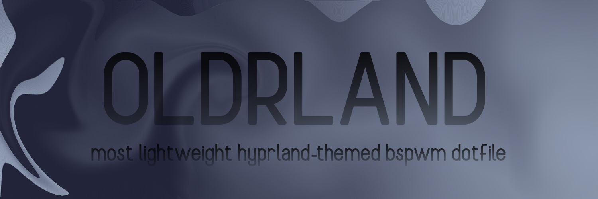
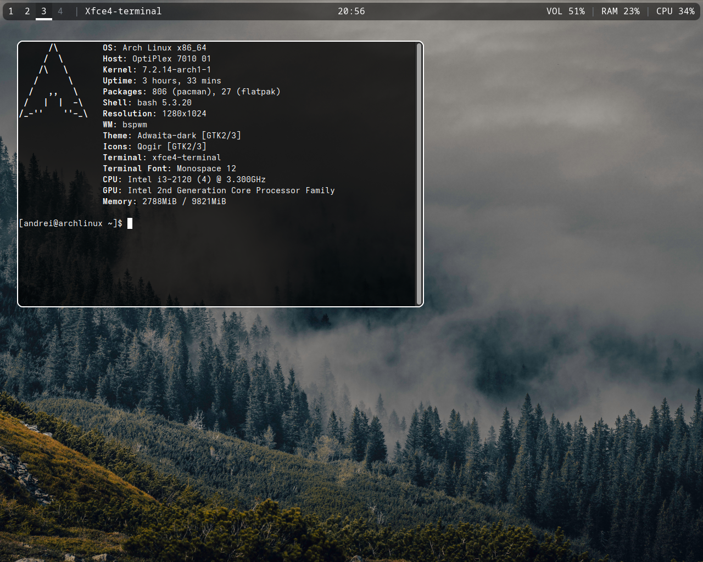

<p align="center">
  
</p>

---

## SPECIAL RELEASE:

this was released on my birthday! i wanted to make this special release as my first ever project, why? i wanted to celebrate my birthday and celebrate my first ever project on GitHub, i just hope this project atleast gets used. thank you!

## Introduction

Hi! this dotfile has been made for older PC's, this dotfile mimics Hyprlands's core fuctions that made it popular, the animations and rounded corners, this thing aims at PC's that need a second life with a lil bit of spice, ive started this project myself without any help.

oldrland already mimics them! It uses picom-ftlabs for the rounded corners, border masking and animations. Ive only tested this on a Arch Linux machine, it has a i3-2120, 10gb RAM and a 256gb hhd, from my experience the animations are great and there are no specific problems with it, everything is smooth. it can even be used on a modern pc, bspwm is lightweight, which makes it fast.

## What are the minimum requirments?

the minimum requirments are:

- 8 gb of ram, if you plan to use the pc for basic tasks like browsing and stuff, 8 gb ram is enough.
- any 64 bit processor from 2011 or later, so the animations and transparency can run great.

## How does it look like?

its clean and sleek, it looks like any hyprland rice but simpler and much more lightweight, heres a screenshot:

<p align="center">
  
</p>

## KNOWN ISSUES

for some reason, its a lil but.. buggy but it doesnt affect your experience, there are no workspace animations like in hyprland and when you resize or tile a window, the rounded corners may turn square then back to rounded.

## Why did you make this project?

Since the creator of Hyprland wont port it to x11, i decided to make it myself, it only requires the window manager itself (bspwm), keybind manager (sxhkd), polybar and the picom fork needed for the animations (picom-ftlabs), its not exactly hyprland-ish.. but it counts as rice..? idfk.


## What dependencies do i need?

you only need:
 - picom-ftlabs (this is a picom fork that includes animations, standard doesnt have any animations)
  
 - dunst (a simple notification manager)
  
 - bspwm (the wm itself)
  
 - polybar (this is the bar you will use, it shows the clock, volume, ram and cpu usage, its useful.)
  
 - nemo (the file manager.)
  
 - firefox (the browser.)
  
 - rofi (the launcher.)
  
 - xfce4-terminal (the terminal, it includes trasnparancy for the terminal window itself.)
***

## - QUICK WARNINGS BEOFRE INSTALLATION:

ill reccomend to do this in a seperate desktop, incase you hit a roadblock, you can troubleshoot it from there.
for example: if you use cinnamon, please do everything from there, all the commands wont overwrite anything from the desktop you are troubleshooting.

## How can i install them?

you need a AUR helper, ill reccomend yay (yet another yogurt).

- bspwm and utilities install command:
  ```bash
  sudo pacman -S bspwm sxhkd xfce4-terminal nemo rofi firefox feh polkit-gnome xclip polybar
  ```

- git installation
  ```bash
  sudo pacman -S --needed git base-devel
  ```
now, lets get the aur helper i said in the first line of this category.

- cloning the repository
  ```bash
  git clone https://aur.archlinux.org/yay.git
  ```

- changing to the directory we cloned
  ```bash
  cd yay
  ```

 - compiling the AUR helper
  ```bash
  makepkg -si
  ```

whats left is the compositor, picom-ftlabs, since we now have yay, we use:
  ```bash
  yay -S picom-ftlabs-git
  ```
  
# How can i install it?

you need to use cat, ill list the command bellow, each having the category at where it will be applied!

- bspwm

```bash
    cat << 'EOF' > ~/.config/bspwm/bspwmrc
    #! /bin/sh

pgrep -x sxhkd > /dev/null || sxhkd &

bspc monitor -d 1 2 3 4

bspc config border_width         2
bspc config window_gap           5

bspc config split_ratio          0.52
bspc config borderless_monocle   true
bspc config gapless_monocle      true

bspc config normal_border_color   "#282a36"
bspc config focused_border_color  "#ffffff"
bspc config presel_feedback_color "#ff79c6"

bspc rule -a Gimp desktop='^8' state=floating follow=on
bspc rule -a Chromium desktop='^2'
bspc rule -a mplayer2 state=floating
bspc rule -a Kupfer.py focus=on
bspc rule -a Screenkey manage=off
bspc config focus_follows_pointer true

pkill sxhkd
sxhkd -c $HOME/.config/sxhkd/sxhkdrc &
wal -R &
feh --bg-fill /home/your_user/Pictures/.custom_wallpapers/image_name &

polybar example &

picom --config $HOME/.config/picom/picom.conf &

xrdb -merge ~/.Xresources &
xsetroot -cursor_name left_ptr &

bspc rule -a ClassName state=floating

/usr/lib/polkit-gnome/polkit-gnome-authentication-agent-1 &
EOF
```

- sxhkd

```bash
cat << 'EOF' > ~/.config/sxhkd/sxhkdrc
super + alt + {Left,Down,Up,Right}
    bspc node -z {left -20 0,bottom 0 20,top 0 -20,right 20 0}

super + ctrl + {Left,Down,Up,Right}
    bspc node -z {right -20 0,top 0 20,bottom 0 -20,left 20 0}

super + j
    bspc node @parent -R 90

super + b
    firefox

super + e
    nemo

super + shift + r
    bspc wm -r && pkill -USR1 -x sxhkd

super + {1,2,3,4,5,6,7,8,9,0}
    bspc desktop -f '^{1,2,3,4,5,6,7,8,9,10}'

super + shift + {1,2,3,4,5,6,7,8,9,0}
    bspc node -d '^{1,2,3,4,5,6,7,8,9,10}'

super + Return
    xfce4-terminal

super + q
    bspc node -c

super + Escape
    bspc quit

super + {Left,Down,Up,Right}
    bspc node -f {west,south,north,east}

super + w
    bspc node -t \~floating
 
super + shift + {Left,Down,Up,Right}
    bspc node -s {west,south,north,east}

super + d
    rofi -show drun
EOF
```
- picom

```bash
cat << 'EOF' > ~/.config/picom/picom.conf
backend = "glx";
vsync = true;
use-damage = false;
log-level = "warn";

corner-radius = 12;

detect-rounded-corners = true;

rounded-corners-exclude = [
    "window_type = 'dock'",
    "window_type = 'desktop'",
    "class_g = 'Polybar'"
];

round-borders = 1;

fading = true;
fade-in-step = 0.03;
fade-out-step = 0.03;
fade-delta = 5;

animations = true;
animation-stiffness = 500.0;
animation-dampening = 25.0;
animation-clipping = true;

animation-for-open-window = "zoom";
animation-for-unmap-window = "zoom";

animation-for-transient-window = "none";
EOF
```
- polybar

```bash
cat << 'EOF' > ~/.config/polybar/config.ini
[colors]
background = #80000000
background-alt = #373B41
foreground = #FFFFFF
primary = #FFFFFF
secondary = #8ABEB7
alert = #A54242
disabled = #707880

[bar/example]
bottom = false
width = 100%
height = 24pt
radius = 10

; dpi = 96

background = ${colors.background}
foreground = ${colors.foreground}

line-size = 3pt

border-size = 4pt
border-color = #00000000

padding-left = 0
padding-right = 1

module-margin = 1

separator = |
separator-foreground = ${colors.disabled}

font-0 = monospace;2

modules-left = xworkspaces xwindow
modules-center = date
modules-right = pulseaudio memory cpu

cursor-click = pointer
cursor-scroll = ns-resize

enable-ipc = true

; wm-restack = generic
; wm-restack = bspwm
; wm-restack = i3

; override-redirect = true

[module/systray]
type = internal/tray

format-margin = 8pt
tray-spacing = 16pt

[module/xworkspaces]
type = internal/xworkspaces

label-active = %name%
label-active-background = #99000000
label-active-underline= ${colors.primary}
label-active-padding = 1

label-occupied = %name%
label-occupied-padding = 1

label-urgent = %name%
label-urgent-background = ${colors.alert}
label-urgent-padding = 1

label-empty = %name%
label-empty-foreground = ${colors.disabled}
label-empty-padding = 1

[module/xwindow]
type = custom/script
interval = 0
exec = if xdotool getactivewindow >/dev/null 2>&1; then xdotool getactivewindow getwindowclassname 2>/dev/null; else echo ""; fi
format = <label>
label = %output%

[module/filesystem]
type = internal/fs
interval = 25

mount-0 = /

label-mounted = %{F#FFFFFF}%mountpoint%%{F-} %percentage_used%%

label-unmounted = %mountpoint% not mounted
label-unmounted-foreground = ${colors.disabled}

[module/pulseaudio]
type = internal/pulseaudio

format-volume-prefix = "VOL "
format-volume-prefix-foreground = ${colors.primary}
format-volume = <label-volume>

label-volume = %percentage%%

label-muted = muted
label-muted-foreground = ${colors.disabled}

[module/xkeyboard]
type = internal/xkeyboard
blacklist-0 = num lock

label-layout = %layout%
label-layout-foreground = ${colors.primary}

label-indicator-padding = 2
label-indicator-margin = 1
label-indicator-foreground = ${colors.background}
label-indicator-background = ${colors.secondary}

[module/memory]
type = internal/memory
interval = 2
format-prefix = "RAM "
format-prefix-foreground = ${colors.primary}
label = %percentage_used:2%%

[module/cpu]
type = internal/cpu
interval = 2
format-prefix = "CPU "
format-prefix-foreground = ${colors.primary}
label = %percentage:2%%

[module/date]
type = internal/date
interval = 1

date = %H:%M
date-alt = %Y-%m-%d %H:%M:%S

label = %date%
label-foreground = ${colors.primary}

[settings]
screenchange-reload = true
pseudo-transparency = true

; vim:ft=dosini
EOF
```

## What if i want to update, will it break?

no, it wont! the packages here are from original sources of course, an update wont break a thing.

## What is the wallpaper you reccomend with this setup?

ill reccomend the ones from pexels.com, they have high quality stock images and its free, heres the link:

https://www.pexels.com/photo/misty-forest-mountainscape-with-dense-fog-34169628/

this photo is made by Raul Ling, the image im showing is what im actively using on my current configuration.

## What do i do after i used cat EOF to copy down the configuration?

log out and log in to you new desktop! you can actually modify it yourself, you can make it more greater, a second reeason for this dotfile is to make users feel more comfortable onto dynamic window managers, or if they want to start with a premade desktop without having the pain of re-writing the config, they can copy this, and start from this.